# MPS — музыкальная студия в кармане

MPS — приложение для Android, в котором можно собрать трек целиком: от бита до готового файла.
Устроено по той же логике, что и FL Studio: **каналы → паттерны → плейлист → микшер**.

| Каналы | Ноты | Плейлист |
|:---:|:---:|:---:|
| 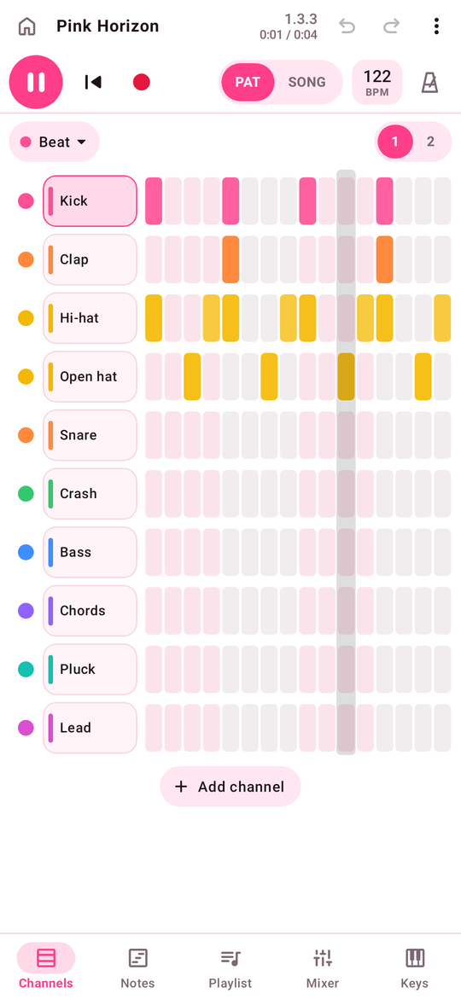 | 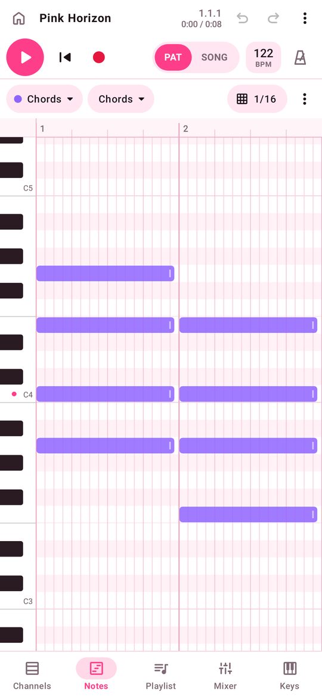 | 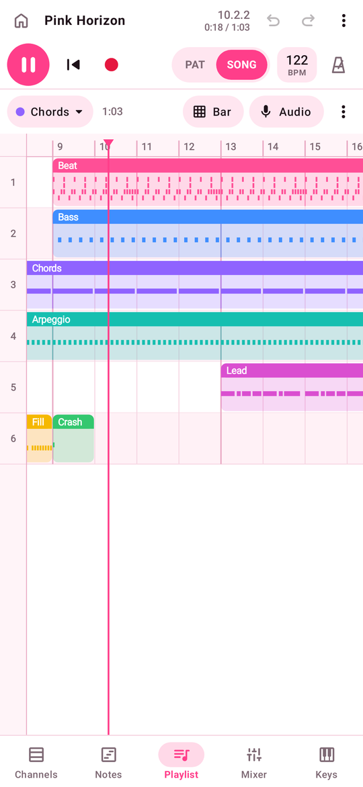 |
| **Микшер** | **Клавиши** | **Инструмент** |
| 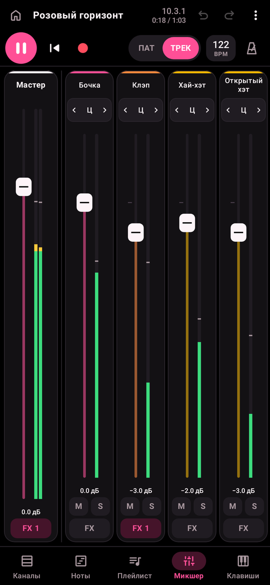 | 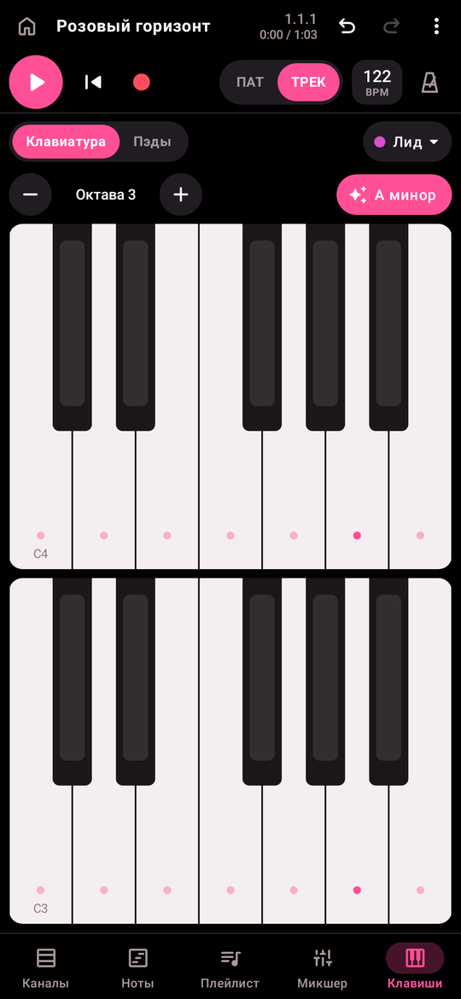 | 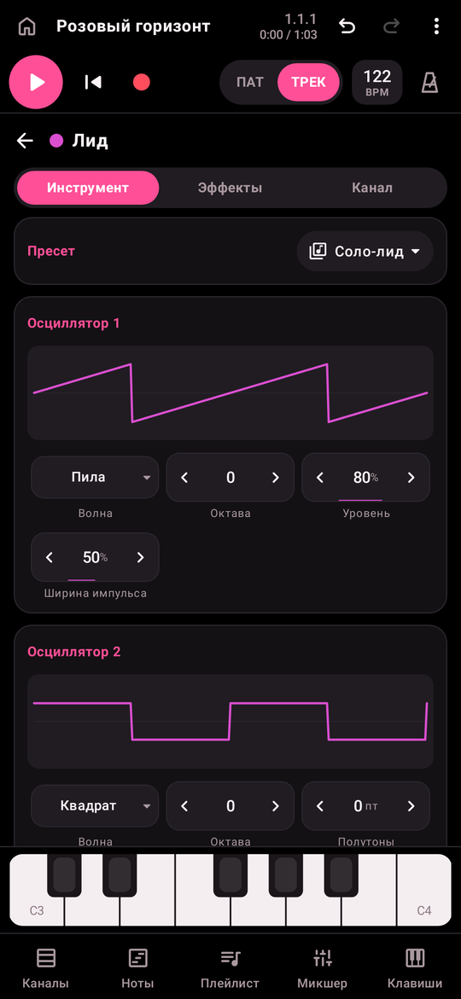 |

Приложение открывается в горизонтальном положении — так на экране помещается больше:

| Плейлист | Экспорт |
|:---:|:---:|
| 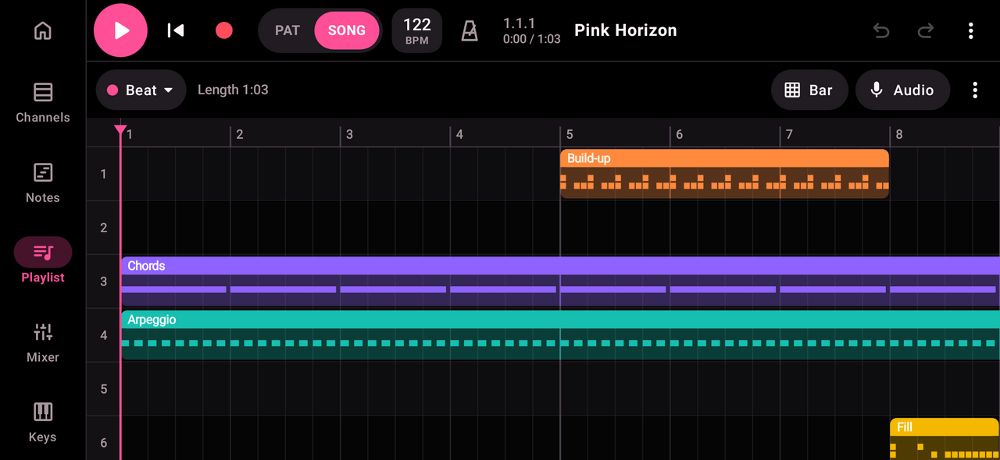 | 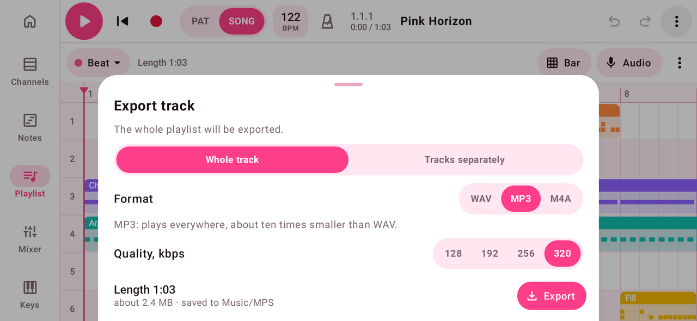 |
| **Мои звуки** | **FM-синтезатор** |
| 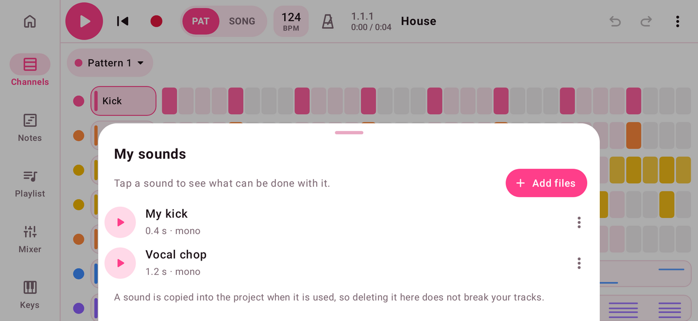 | 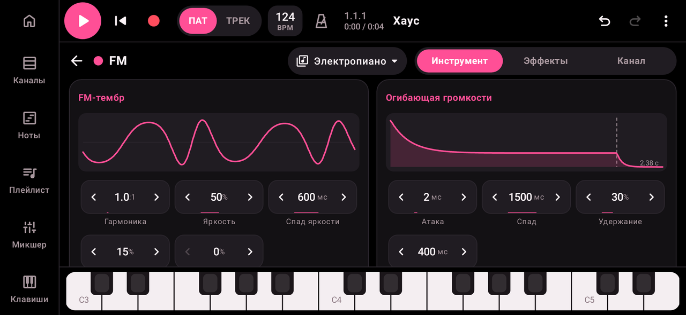 |
| **Сообщество** | **Публикация и оценки** |
| 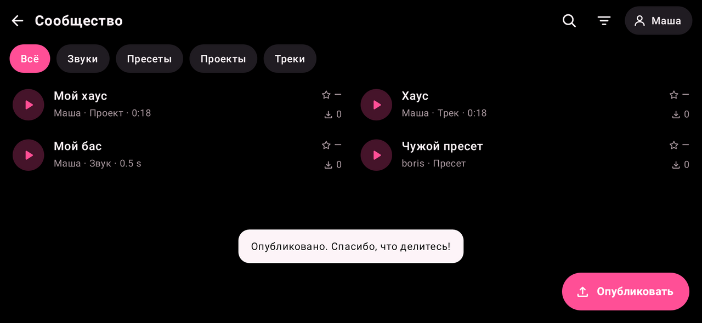 | 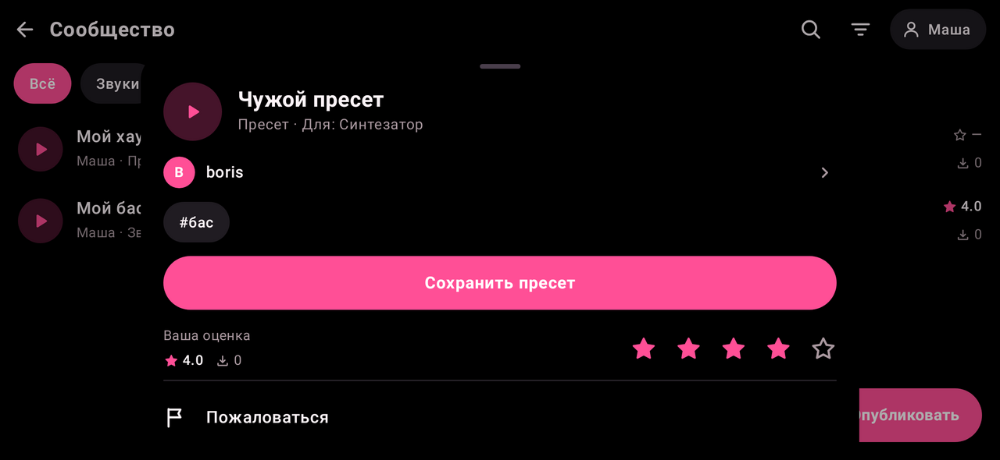 |

## Что умеет

**Сочинять**
- **Каналы** — пошаговый секвенсор: нажал на клетку — появился удар, провёл пальцем — нарисовал несколько.
- **Ноты** — пианоролл: нажатие ставит ноту, перетаскивание двигает, правый край меняет длину;
  выделение рамкой (задержать палец и тянуть), сетка от 1/4 до 1/32, громкость нот, копирование,
  сдвиг на полутон и на октаву, «призраки» нот других каналов.
- **Автоматизация** — под нотами пальцем рисуется кривая для любой ручки канала: громкости, баланса,
  параметров инструмента и эффектов. Кривая живёт в паттерне и играет вместе с ним, а в остальных
  паттернах ручка стоит там, где её оставили ([как это выглядит](docs/screenshots/automation_light.png)).
- **Плейлист** — собирает паттерны в трек: до 16 дорожек, перетаскивание и растягивание клипов,
  разрезание, зацикливание участка.
- **Клавиши** — мультитач-клавиатура с подсветкой лада и пэды для ударных.

**Звук**
- **Ударные** — 11 синтезируемых звуков: бочка, 808-бас, снейр, клэп, хэты, том, римшот, ковбелл, крэш, шейкер.
- **Синтезатор** — два осциллятора, саб, шум, фильтр, две огибающие, LFO, унисон; 19 готовых пресетов.
- **FM-синтезатор** — звонкие и «стеклянные» тембры, которых не даёт обычный синтезатор: электропиано, колокол,
  стеклянные клавиши, маримба, орган, медные и плотный бас.
- **Струна** — физическая модель щипковой струны: гитара, нейлон, арфа, кото, клавесин, глушёная струна, щипковый бас.
- **Сэмплер** — играет по нотам любой аудиофайл с телефона или звук из «Моих звуков».
- **Аудиоканалы** — запись с микрофона и импорт лупов прямо в плейлист.
- **15 эффектов** — эквалайзер, компрессор, реверб, дилэй, фильтр, дисторшн, хорус, фэйзер, флэнжер, биткрашер,
  тремоло / автопан, «качалка» (эффект сайдчейна), стереоширина, лента и лимитер. До 6 на канал и столько же на мастер.
- Тип инструмента у канала можно сменить в любой момент (ударные, синтезатор, FM-синтезатор, струна, сэмплер) —
  ноты остаются на месте.

**Свои звуки и пресеты**
- **Мои звуки** — общая для всех проектов библиотека ваших аудиофайлов: добавьте сразу несколько, прослушайте,
  переименуйте. Любой звук одним нажатием становится новым каналом, звуком уже открытого сэмплера или клипом
  в плейлисте. Запись с микрофона и файл, загруженный в сэмплер, тоже можно оставить в библиотеке.
- **Пресеты** — у каждого инструмента и эффекта есть готовые настройки (19 у синтезатора, по 7 у FM-синтезатора
  и струны, от трёх до пяти у каждого эффекта), а свои можно сохранить под именем — они будут видны во всех проектах
  ([как это выглядит](docs/screenshots/landscape_presets.png)).

**Сообщество**
- Каталог того, чем делятся другие: **звуки** (удары и лупы), **пресеты** инструментов и эффектов,
  **проекты** целиком и готовые **треки**. Поиск по названию, автору и тегам, сортировка по новизне,
  числу скачиваний и оценке.
- Всё можно послушать до скачивания. Пресет при этом ничего не качает: приложение играет его на своём инструменте.
- Одно нажатие — и звук оказывается в «Моих звуках», пресет — среди ваших пресетов, проект — в списке проектов.
- Свои публикации: звук из «Моих звуков», сохранённый пресет, проект (к нему прикладывается MP3 для прослушивания)
  или трек, который приложение само сводит в MP3.
- Профили авторов с числом публикаций, скачиваний и средней оценкой; оценки от 1 до 5; жалобы и скрытие
  публикаций, на которые пожаловались несколько человек.
- Смотреть, слушать и скачивать можно без аккаунта; чтобы публиковать и оценивать — зарегистрироваться по почте
  (адрес подтверждается кодом из письма) или войти через Google. Забытый пароль меняется так же, по коду из письма.
- Работает на бесплатном тарифе Supabase; как подключить свой проект — в [supabase/README.md](supabase/README.md).

**Работа над треком**
- Микшер с индикаторами уровня, панорамой, mute / solo и цепочкой эффектов мастера.
- Запись игры на клавишах и пэдах в паттерн (с отсчётом и выравниванием по сетке).
- Запись с микрофона: отсчёт, полоса со временем и уровнем сигнала, подсказка, если микрофон «молчит»;
  тихая запись сама выравнивается по громкости, а готовый дубль появляется на свободной дорожке плейлиста
  ([как это выглядит](docs/screenshots/landscape_recording.png)).
  В настройках видно, как микрофон включился в последний раз: источник, частота, длина и пик записи.
- MIDI-клавиатуры: по USB, а также Bluetooth-устройства, уже подключённые к системе.
- Метроном, tap tempo, свинг. Повторное нажатие «Стоп» обрывает хвосты реверба и эха.
- Отмена и повтор действий, автосохранение.
- Экспорт трека в WAV, MP3 (128–320 кбит/с) и AAC (.m4a) в папку `Music/MPS`, можно сразу поделиться.
- Экспорт по дорожкам: каждый канал — отдельным WAV-файлом одной длины (стемы), чтобы доделать сведение в другой программе.
- Проект целиком в одном файле `.mps` — ноты, настройки и все звуки: резервная копия и перенос на другой телефон.
  Сохраняется из меню проекта, открывается кнопкой «Открыть файл» на главном экране.
- Длина трека в минутах и секундах: рядом с позицией в панели управления, в плейлисте и в окне экспорта.
- Горизонтальный экран: приложение открывается «на боку», где помещается больше шагов, тактов и каналов микшера;
  в настройках можно включить автоповорот или вертикальный режим.
- Шаблоны (House, Trap, Lo-fi) и демо-трек, который можно открыть и разобрать.
- Две темы — бело-розовая и чёрно-розовая; русский и английский языки, переключаются в настройках.

## Низкая задержка звука

Звуковой движок написан с нуля и работает по правилам реального времени:

- звук идёт на родной частоте и родном размере блока устройства, поэтому система не пересчитывает его лишний раз;
- выход открывается в режиме `PERFORMANCE_MODE_LOW_LATENCY` (быстрый путь Android в обход обычного микшера);
- буфер начинается с двух блоков и растёт только если устройство действительно не успевает
  (срывы в первые полсекунды после открытия выхода не считаются, а найденный размер запоминается до закрытия приложения);
- звуковой поток не выделяет память, не берёт блокировок и не обращается к файлам — команды от интерфейса
  приходят через очередь без блокировок;
- системе сообщается, сколько времени занимает расчёт блока (ADPF), чтобы процессор не «засыпал» между блоками;
- при запуске движок «прогревается» в фоне — беззвучно проигрывает все инструменты и эффекты, — чтобы Android успел
  скомпилировать его до первой ноты; в варианте release он скомпилирован заранее (baseline profile).

В настройках можно выбрать запас буфера и увидеть реальные цифры: частоту, размер буфера, задержку выхода
(измеренную системой, а если устройство её не сообщает — оценку по размеру буфера), работает ли быстрый путь
и сколько было срывов звука.

## Сборка

Нужны:
- Android Studio свежей версии (AGP 9.2, Gradle 9.4 — подтянутся сами);
- **SDK Platform 37** (SDK Manager → SDK Platforms) — её требуют библиотеки AndroidX, указанные в проекте;
- телефон или эмулятор с Android 12 и новее.

```
./gradlew :app:assembleDebug        # собрать APK
./gradlew :app:installRelease       # собрать быстрый вариант и поставить на подключённый телефон
./gradlew :app:testDebugUnitTest    # тесты звукового движка
```

Задержку и нагрузку оценивайте на варианте **release** (в Android Studio: Build Variants → release): отладочная
сборка работает заметно медленнее. Без своего ключа вариант release подписывается отладочным, поэтому ставится
на телефон так же просто, как debug.

Для публикации нужен свой ключ. Положите в корень проекта файл `keystore.properties` (в репозиторий он не попадает):

```
storeFile=/путь/к/ключу.jks
storePassword=...
keyAlias=mps
keyPassword=...
```

После этого `./gradlew :app:assembleRelease` подписывает им `app/build/outputs/apk/release/app-release.apk`.
Ключ и пароль берегите: обновление ставится поверх приложения только с той же подписью.

## Как устроен код

```
app/src/main/java/jxpix/proger/mps/
  engine/    звуковой движок: секвенсор, инструменты, эффекты, офлайн-рендер, WAV
  model/     проект (каналы, паттерны, клипы), пресеты, шаблоны, чистые функции правки
  audio/     вывод звука, запись с микрофона, декодирование и экспорт, MIDI
  data/      хранение проектов, настроек, библиотеки звуков и своих пресетов
  cloud/     сообщество: клиент сервера, вход, загрузка и скачивание
  studio/    состояние приложения: открытый проект, транспорт, отмена, запись
  ui/        экраны на Jetpack Compose
```

Движок не зависит от Android и проверяется обычными JVM-тестами: шаблоны рендерятся в звук,
после чего проверяются уровни, отсутствие клиппинга и работа лимитера. Отдельные тесты проверяют
автоматизацию и то, что звуковой поток во время игры не выделяет память.

Рядом с приложением лежат [`supabase/`](supabase) — схема и проверки сервера сообщества — и [`site/`](site) — сайт.

## Сайт

[mp-studio.online](https://mp-studio.online) — страница приложения на русском и английском: что умеет MPS,
скачивание APK, опрос «Как вы делаете музыку?», обратная связь, правила сообщества и политика конфиденциальности.
На форму обратной связи ведёт и пункт «Оставить отзыв» в настройках приложения: он передаёт версию приложения
и модель телефона. Ответы и отзывы владелец смотрит на закрытой странице `/admin/`: сводка по каждому вопросу,
отдельные анкеты, число скачиваний, выгрузка в CSV.

Сайт — обычный PHP без фреймворков и сборки (PHP 8.0 и новее, MySQL или MariaDB). Исходники — в
[`site/public`](site/public), готовый архив — [`site/mps-site.zip`](site/mps-site.zip). Паролей в архиве нет.

Как поставить:

1. В панели хостинга создайте сайт и базу данных MySQL.
2. Загрузите `mps-site.zip` в папку сайта и распакуйте его там. Страницу-заглушку хостинга (`index.html`) удалите.
3. Откройте `https://ваш-сайт/admin/`. Страница спросит имя базы, её пользователя и пароль и попросит придумать
   пароль для неё самой. Данные базы остаются на хостинге, в файле `app/data/db.php`.

Чтобы обновить сайт, распакуйте новый архив поверх старого: настройки и ответы останутся на месте.
Если пароль страницы `/admin/` забыт, удалите `app/data/db.php` и откройте её снова.

Ссылку на опрос удобно раздавать с меткой: `/survey/?src=telegram` — в сводке видно, откуда пришли люди.
Пока база данных недоступна, ответы не теряются: они ждут в файле на хостинге и попадают в базу, когда она вернётся.

Архив собирает `python3 site/pack.py`. APK для страницы скачивания кладётся в `site/public/download/`
(в имени файла должна быть версия, например `mps-1.0.apk`) и попадает в архив; без него страница пишет,
что приложение скоро появится.

## Состояние проекта

Проверено при разработке:
- проект собирается, lint не находит ошибок;
- тесты движка проходят; у новых инструментов проверены строй (расхождение — несколько центов), громкость пресетов
  и то, что они не выделяют память в звуковом потоке;
- все экраны отрисованы и «прокликаны» вне устройства (обе темы, оба языка, портрет и альбом, маленький экран):
  воспроизведение, зацикливание паттерна, запись нот, рисование шагов, нот и кривых автоматизации, перенос клипов, фейдеры,
  отмена, сохранение и повторное открытие проекта, экспорт в WAV и MP3, экспорт по дорожкам,
  сохранение проекта в файл и открытие из файла, библиотека «Мои звуки», сохранение и применение пресетов,
  добавление новых инструментов и эффектов;
- запись с микрофона пройдена целиком на подставном микрофоне: отсчёт, уровень, выравнивание громкости,
  появление клипа в плейлисте и его воспроизведение;
- MP3-файлы, записанные приложением, прочитаны сторонним декодером (mpg123) и сверены с исходным звуком;
  сумма отдельных дорожек совпадает с миксом без мастер-обработки.

- сообщество: правила доступа базы проверены на настоящем PostgreSQL от имени разных людей; экраны пройдены
  целиком на локальной копии сервера (каталог, прослушивание, скачивание, регистрация, публикация звука,
  пресета, проекта и трека, оценки, жалобы, профиль, модерация). **На настоящем проекте Supabase** тем же
  кодом приложения проверены: регистрация и вход по почте, публикация звука, пресета, трека (сведение в MP3)
  и проекта, прослушивание и скачивание с сервера, возврат проекта в список проектов, оценки и счётчик
  скачиваний, жалобы и модерация, лимиты (размер файла, тип файла, место автора), удаление публикаций и
  аккаунта, а также регистрация с кодом из настоящего письма и смена забытого пароля по коду.
  Не проверены: вход через Google (он не настроен) и воспроизведение треков прямо с сервера на телефоне.
- сайт: все страницы открыты в браузере на ширине телефона и компьютера на обоих языках; опрос и обратная связь
  пройдены так, как их заполняет человек, и отправлены «вручную» с неверными данными; первая настройка, закрытая
  страница, работа без базы данных и возвращение ответов в базу проверены на Apache с PHP 8.5 — на том самом
  архиве, что лежит в репозитории.

**Ещё не проверено на настоящем устройстве.** Только на нём можно увидеть реальную задержку и нагрузку,
работу микрофона, MIDI-устройств, кодировщика AAC, системного выбора файлов и сохранения в папку «Музыка».
Если микрофон не записывает, откройте настройки, раздел «Запись»: строка «Микрофон, последнее включение»
показывает, с какого источника и на какой частоте он открылся и какой была громкость.

Чего пока нет:
- подключения сторонних плагинов: все инструменты и эффекты встроенные. В Android нет общего стандарта вроде VST;
  поддержка открытого формата AAP (Audio Plugins for Android) — в планах;
- посылов (send) в общие эффекты;
- автоматизации мастер-канала, темпа и аудиодорожек — кривые есть только у каналов с нотами, внутри паттерна;
- растягивания аудио по темпу;
- нативного вывода через Oboe / AAudio — сейчас используется быстрый путь `AudioTrack`.

## Лицензии

Значки интерфейса — [Material Symbols](https://fonts.google.com/icons) (Apache License 2.0).

MP3-кодировщик — [jump3r](https://git.iem.at/sciss/jump3r), перенос LAME на Java (GNU LGPL 2.1 или новее).
Подключён как неизменённая библиотека из Maven Central; при публикации приложения упомяните её и лицензию
в описании или в разделе «О приложении».

---

## In English

MPS is a pocket music studio for Android built around the FL Studio workflow: channel rack (step sequencer),
piano roll, playlist, mixer, keyboard and pads. It ships with a drum synthesizer, a polyphonic synthesizer with
19 presets, an FM synthesizer, a plucked-string model, a sampler, audio tracks with microphone recording,
15 effects, built-in and user presets for every instrument and effect, a library of your own sounds shared
by all projects, per-pattern automation curves for any channel knob, MIDI keyboard input, undo / redo, a community catalogue for sharing sounds, presets,
projects and tracks (profiles, ratings, reports; backed by a free Supabase project, see `supabase/`),
WAV, MP3 and AAC export, per-channel stem export (WAV), self-contained project files (`.mps`) for backup and
moving between phones, a landscape-first layout, light and dark pink themes, and English and Russian interfaces.
Sign-up is confirmed with a six-digit code sent by e-mail; a forgotten password is changed the same way.

The website ([mp-studio.online](https://mp-studio.online): landing page, APK download, a survey, a feedback form
and a private page with the answers) is plain PHP in `site/public`; `site/mps-site.zip` is the archive to unpack
on a hosting. It holds no passwords: the first visit to `/admin/` asks for the database and keeps it on the server.

The audio engine is written from scratch in Kotlin and follows real-time rules: native sample rate and burst
size, low-latency `AudioTrack` mode, an adaptive buffer, and an audio thread that never allocates or locks.

Build with a recent Android Studio and **SDK Platform 37** installed; the app runs on Android 12 and newer.
The app has been compiled, linted, unit-tested and exercised off-device, but **not yet run on a physical device**.
